# ooops-practice-03 — git: удалённый репозиторий, конфликты, ветки

Практическая работа №3: локальный git-репозиторий, привязка к пустому репозиторию
на GitHub, доступ по SSH-ключу, разрешение конфликта слияния и работа с веткой.

Работа выполнена в этом же репозитории: две рабочие копии — на хост-машине и на ВМ —
правят файл [`hello.test`](hello.test) и отправляют изменения в один удалённый репозиторий.

## Содержимое репозитория

| Путь | Описание |
| --- | --- |
| [`hello.test`](hello.test) | Файл, на котором отрабатывался конфликт слияния |
| [`screenshots/`](screenshots/) | Скриншоты, подтверждающие выполнение каждого шага |
| `README.md` | Описание работы |

В ветке [`feat-124`](https://github.com/speicherleck/ooops-practice-03/tree/feat-124)
дополнительно лежит файл `feat.123`.

## Стенд

| Рабочая копия | Машина | Доступ к GitHub |
| --- | --- | --- |
| `~/Документы/devops/ooops-practice-03` | хост, Linux Mint 22.3 | HTTPS |
| `~/ooops-practice-03` | ВМ Ubuntu Server 24.04 (стенд из практики №1), пользователь `student` | SSH-ключ `~/.ssh/id_ed25519` |

git 2.43.0 на обеих машинах, аккаунт GitHub — [`speicherleck`](https://github.com/speicherleck).

## Ход работы

### 1. Пустой репозиторий на GitHub

Репозиторий `ooops-practice-03` создан без README, лицензии и `.gitignore`. GitHub
предлагает команды для нового и для существующего локального репозитория — нужен
второй вариант (*…or push an existing repository from the command line*):

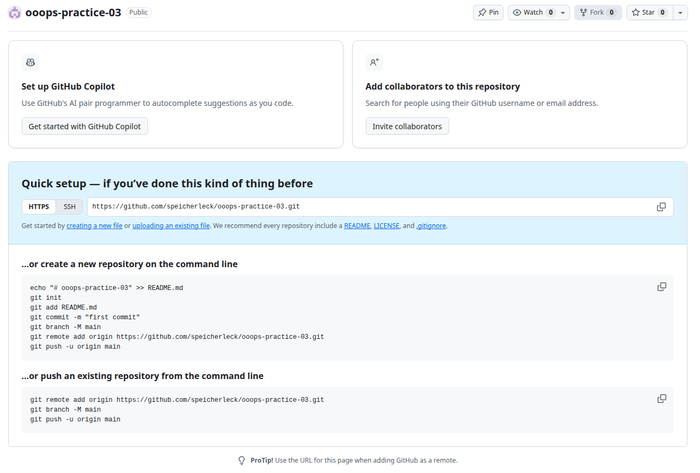

### 2. Локальный репозиторий и первый push

На хосте создан локальный репозиторий с README, сделан первый коммит, подключён
удалённый репозиторий и отправлена ветка `main`:

```bash
git init
git add .
git commit -m "initia commit"
git remote add origin https://github.com/speicherleck/ooops-practice-03.git
git branch -M main
git push -u origin main
```

`origin` к этому моменту уже был добавлен, отсюда сообщение
`внешний репозиторий origin уже существует` — на push это не влияет:

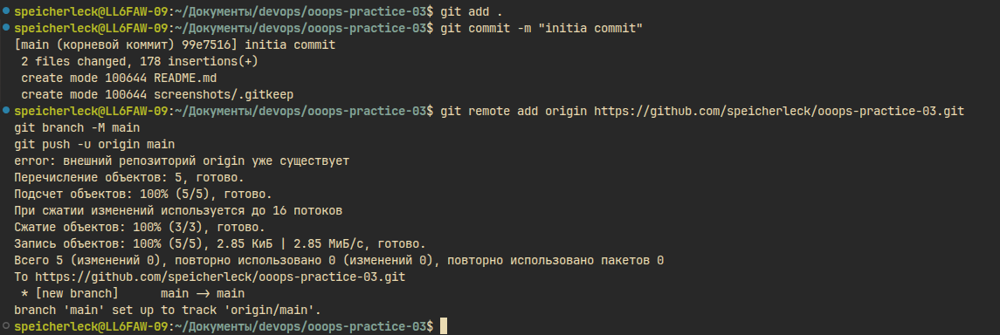

### 3. SSH-ключ

На ВМ сгенерирован ключ `~/.ssh/id_ed25519`, открытая часть добавлена в профиль GitHub:
*Settings → SSH and GPG keys → New SSH key*.

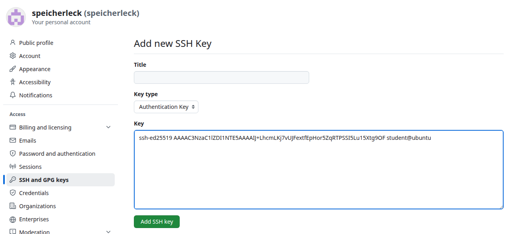

На ВМ ключ загружен в ssh-agent, адрес `origin` переключён с HTTPS на SSH, после чего
push, pull и коммит проходят по ключу:

```bash
eval `ssh-agent`
ssh-add ~/.ssh/id_ed25519
git remote set-url origin git@github.com:speicherleck/ooops-practice-03.git
git push origin main
git pull origin main
git add .
git commit -m "test"
git push origin main
```

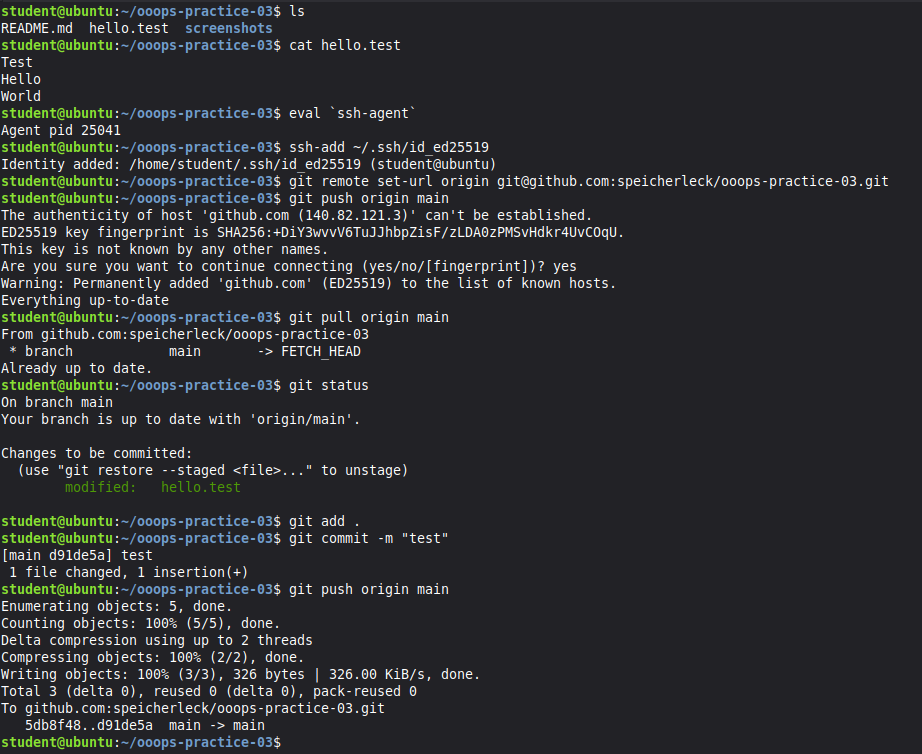

### 4. Конфликт изменений

Обе копии синхронизированы. На ВМ строка `Hello` в `hello.test` изменена,
закоммичена и отправлена на сервер:

```bash
git pull
sed -i 's/^Hello$/Hello from VM/' hello.test
git commit -am "vm change"
git push
```

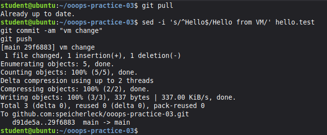

На хосте без `git pull` та же строка изменена по-другому и закоммичена локально:

```bash
sed -i 's/^Hello$/Hello from host/' hello.test
git commit -am "host change"
```

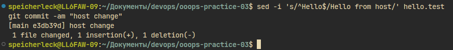

Сервер отклоняет push (`rejected … fetch first`): на нём есть коммит, которого
нет локально.

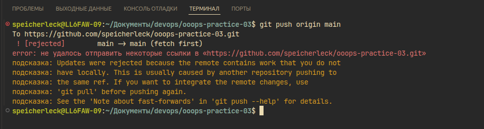

`git pull` скачивает изменения с сервера, но не может слить их автоматически: обе
версии изменили одну и ту же строку — `КОНФЛИКТ (содержимое)` в `hello.test`.
В файле обе версии разделены маркерами `<<<<<<<`, `=======`, `>>>>>>>`:

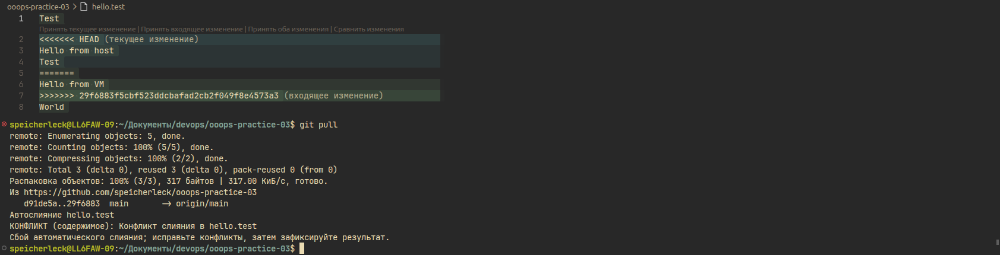

### 5. Разрешение конфликта

Маркеры удалены, строка отражает обе правки — `Hello from host and from VM`.
`git status` показывает файл в «не слитых путях»; слияние завершено обычным
коммитом, теперь push принимается:

```bash
git status
git add hello.test
git commit -m "fixedd"
git push origin main
```

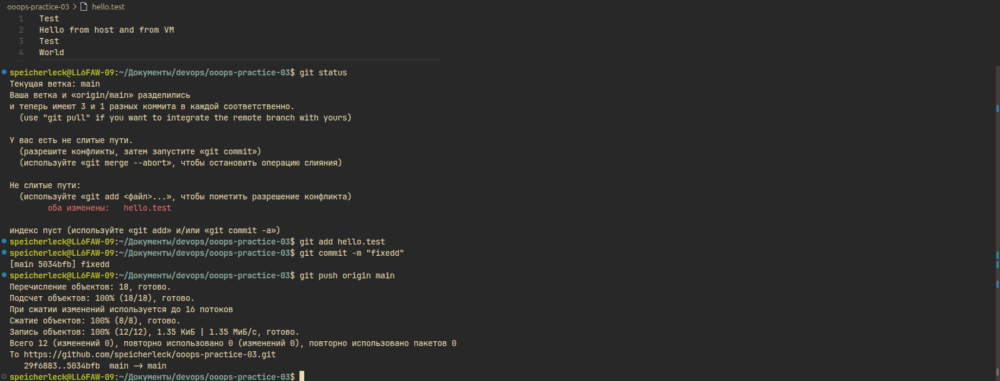

На ВМ `git pull` подтягивает итоговую версию (fast-forward):

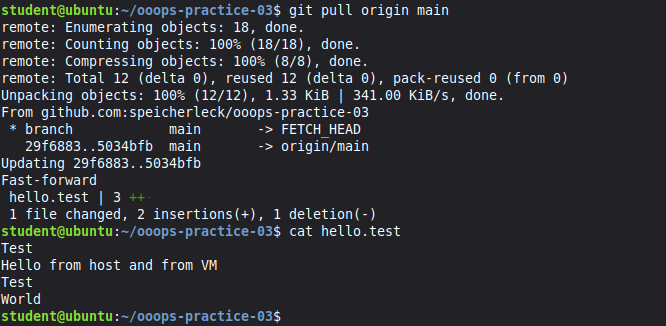

### 6. Новая ветка

На ВМ создана ветка `feat-124`, в неё закоммичен новый файл, ветка отправлена
на сервер с созданием одноимённой удалённой ветки:

```bash
git checkout -b feat-124
touch feat.123
git add .
git commit -m "feat"
git push origin feat-124
```

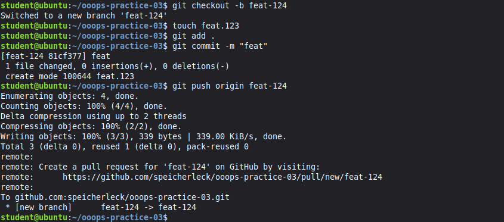

На GitHub появились две ветки, `feat-124` на один коммит впереди `main`:

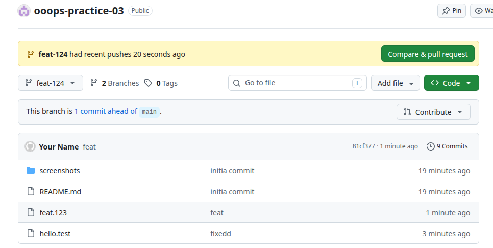

## Результат

* создан репозиторий на GitHub, к нему подключены две локальные копии — по HTTPS
  с хоста и по SSH-ключу с ВМ;
* создан и вручную разрешён конфликт слияния между правками одной строки
  `hello.test` с хоста и с ВМ, итоговая версия отправлена на сервер и получена на ВМ;
* создана ветка `feat-124` и опубликована на сервере, на GitHub видны обе ветки.
